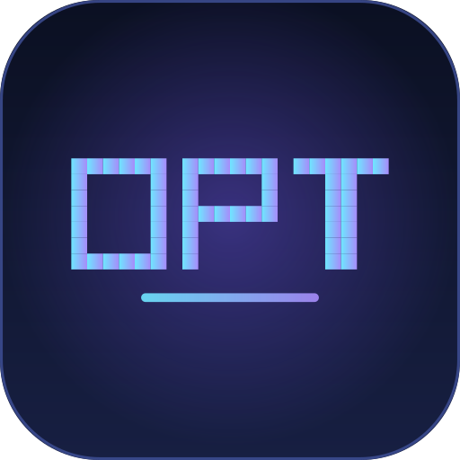
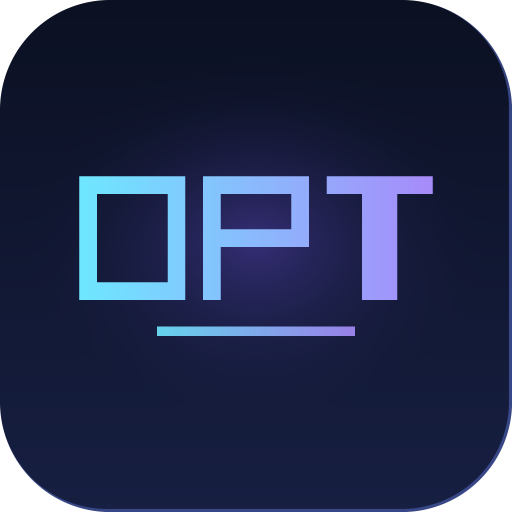
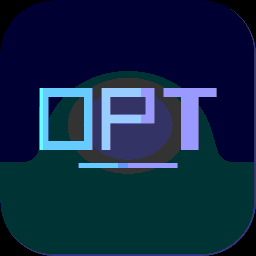
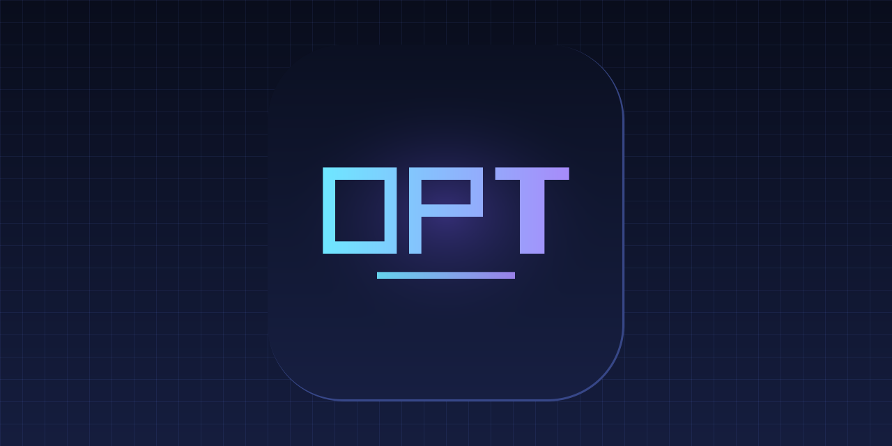

<div align="center">



# TheDPT

**DPT** — DartPower Team. Одно слово на 371 языках, форматах и кодеках.

[](LICENSE)
[](https://github.com/DartPower/TheDPT/actions/workflows/ci.yml)
[](#каталог)
[](package.json)
[](#как-это-сделано)

</div>

---

## Что это такое

Есть [легендарный репозиторий](https://github.com/eeeeeeeeeeeeeeeeeeeeeeeeeeeeeeee/eeeeeeeeeeeeeeeeeeeeeeeeeeeeeeeeeeeeeeeeeeeeeeeeeeeeeeeeeeeeeeeeeeeeeeeeeeeeeeeeeeeeeeeeeeeeeeeeeeee),
в котором 500 файлов называются `e` и внутри каждого написано `e`.
Этот репозиторий — то же самое, но про **DartPower Team** и с уважением к форматам:
здесь не просто `DPT` текстом, а ещё и настоящие PNG, GIF, WAV, MIDI, ZIP, DOCX, TTF, WASM,
торрент и ключ RSA.

Всё лежит в одной папке [`dpt/`](dpt) и называется `DPT.<расширение>`.
Никаких `hello-world`, никаких `example` — только `DPT`.

```console
$ ls dpt | head -5
DPT.ada
DPT.ahk
DPT.aiff
DPT.ans
DPT.apk
```

## Быстрый старт

```bash
git clone https://github.com/DartPower/TheDPT.git
cd TheDPT

python dpt/DPT.py          # DPT
node   dpt/DPT.js          # DPT
sh     dpt/DPT             # DPT
pwsh   dpt/DPT.ps1         # DPT

ffplay -autoexit dpt/DPT.wav   # -.. .--. -   (морзянка)
```

Посмотреть глазами: [`dpt/DPT.png`](dpt/DPT.png) · [`dpt/DPT.svg`](dpt/DPT.svg) ·
[`dpt/DPT.gif`](dpt/DPT.gif) · [`dpt/DPT.mp4`](dpt/DPT.mp4)

<table>
<tr>
<td align="center"><br><sub>PNG</sub></td>
<td align="center"><br><sub>GIF</sub></td>
<td align="center"><br><sub>баннер</sub></td>
</tr>
</table>

Услышать: [`dpt/DPT.wav`](dpt/DPT.wav) — это `-.. .--. -`, то есть D, P, T морзянкой:
точка 90 мс, тире 270 мс, тон 720 Гц. То же самое лежит в MIDI, AIFF, AU и во всех
сжатых аудиоформатах.

## Каталог

Всего **371** файлов. Полная версия с размерами — в [`docs/FORMATS.md`](docs/FORMATS.md).

### Языки программирования

Каждый файл — маленькая программа, которая печатает `DPT`.

| Файл | Формат | Что это |
| --- | --- | --- |
| [`DPT.py`](dpt/DPT.py) | Python | печатает `DPT` |
| [`DPT.pyw`](dpt/DPT.pyw) | Python (windowless) | то же, но без консоли |
| [`DPT.ipynb`](dpt/DPT.ipynb) | Jupyter Notebook | ноутбук с одной ячейкой |
| [`DPT.js`](dpt/DPT.js) | JavaScript | печатает `DPT` |
| [`DPT.mjs`](dpt/DPT.mjs) | JavaScript (ESM) | ES-модуль, печатает `DPT` |
| [`DPT.cjs`](dpt/DPT.cjs) | CommonJS | модуль для Node |
| [`DPT.jsx`](dpt/DPT.jsx) | React JSX | компонент `<DPT />` |
| [`DPT.ts`](dpt/DPT.ts) | TypeScript | типизированный `DPT` |
| [`DPT.tsx`](dpt/DPT.tsx) | TypeScript + JSX | типизированный компонент |
| [`DPT.coffee`](dpt/DPT.coffee) | CoffeeScript | печатает `DPT` |
| [`DPT.dart`](dpt/DPT.dart) | Dart | печатает `DPT` |
| [`DPT.java`](dpt/DPT.java) | Java | печатает `DPT` |
| [`DPT.kt`](dpt/DPT.kt) | Kotlin | печатает `DPT` |
| [`DPT.kts`](dpt/DPT.kts) | Kotlin Script | скрипт, печатает `DPT` |
| [`DPT.scala`](dpt/DPT.scala) | Scala | печатает `DPT` |
| [`DPT.sc`](dpt/DPT.sc) | Scala Script | скрипт-однострочник |
| [`DPT.groovy`](dpt/DPT.groovy) | Groovy | печатает `DPT` |
| [`DPT.clj`](dpt/DPT.clj) | Clojure | печатает `DPT` |
| [`DPT.cljs`](dpt/DPT.cljs) | ClojureScript | печатает `DPT` в консоль |
| [`DPT.cljc`](dpt/DPT.cljc) | Clojure (common) | работает и в JVM, и в JS |
| [`DPT.edn`](dpt/DPT.edn) | EDN | данные: команда DPT |
| [`DPT.ex`](dpt/DPT.ex) | Elixir | печатает `DPT` |
| [`DPT.exs`](dpt/DPT.exs) | Elixir Script | скрипт, печатает `DPT` |
| [`DPT.erl`](dpt/DPT.erl) | Erlang | печатает `DPT` |
| [`DPT.hrl`](dpt/DPT.hrl) | Erlang Header | заголовок с макросом |
| [`DPT.hs`](dpt/DPT.hs) | Haskell | печатает `DPT` |
| [`DPT.lhs`](dpt/DPT.lhs) | Literate Haskell | текст, который компилируется |
| [`DPT.ml`](dpt/DPT.ml) | OCaml | печатает `DPT` |
| [`DPT.mli`](dpt/DPT.mli) | OCaml Interface | сигнатура модуля |
| [`DPT.fs`](dpt/DPT.fs) | F# | печатает `DPT` |
| [`DPT.fsx`](dpt/DPT.fsx) | F# Script | скрипт, печатает `DPT` |
| [`DPT.vb`](dpt/DPT.vb) | Visual Basic .NET | печатает `DPT` |
| [`DPT.cs`](dpt/DPT.cs) | C# | печатает `DPT` |
| [`DPT.c`](dpt/DPT.c) | C | печатает `DPT` |
| [`DPT.h`](dpt/DPT.h) | C Header | заголовок с константой |
| [`DPT.cpp`](dpt/DPT.cpp) | C++ | печатает `DPT` |
| [`DPT.hpp`](dpt/DPT.hpp) | C++ Header | шаблон `dpt::hello` |
| [`DPT.cc`](dpt/DPT.cc) | C++ (cc) | тот же C++, другое расширение |
| [`DPT.m`](dpt/DPT.m) | Objective-C | печатает `DPT` |
| [`DPT.mm`](dpt/DPT.mm) | Objective-C++ | печатает `DPT` |
| [`DPT.swift`](dpt/DPT.swift) | Swift | печатает `DPT` |
| [`DPT.go`](dpt/DPT.go) | Go | печатает `DPT` |
| [`DPT.rs`](dpt/DPT.rs) | Rust | печатает `DPT` |
| [`DPT.rb`](dpt/DPT.rb) | Ruby | печатает `DPT` |
| [`DPT.rake`](dpt/DPT.rake) | Rakefile (Ruby DSL) | задача `dpt` |
| [`DPT.php`](dpt/DPT.php) | PHP | печатает `DPT` |
| [`DPT.phtml`](dpt/DPT.phtml) | PHP Template | HTML + PHP |
| [`DPT.pl`](dpt/DPT.pl) | Perl | печатает `DPT` |
| [`DPT.pm`](dpt/DPT.pm) | Perl Module | модуль `DPT` |
| [`DPT.raku`](dpt/DPT.raku) | Raku | печатает `DPT` |
| [`DPT.lua`](dpt/DPT.lua) | Lua | печатает `DPT` |
| [`DPT.tcl`](dpt/DPT.tcl) | Tcl | печатает `DPT` |
| [`DPT.awk`](dpt/DPT.awk) | AWK | печатает `DPT` |
| [`DPT.sed`](dpt/DPT.sed) | sed | заменяет `hello` на `DPT` |
| [`DPT.sh`](dpt/DPT.sh) | POSIX Shell | печатает `DPT` |
| [`DPT.bash`](dpt/DPT.bash) | Bash | печатает `DPT` |
| [`DPT.zsh`](dpt/DPT.zsh) | Zsh | печатает `DPT` |
| [`DPT.fish`](dpt/DPT.fish) | Fish | печатает `DPT` |
| [`DPT.ps1`](dpt/DPT.ps1) | PowerShell | печатает `DPT` |
| [`DPT.psm1`](dpt/DPT.psm1) | PowerShell Module | функция `Get-DPT` |
| [`DPT.bat`](dpt/DPT.bat) | Batch | печатает `DPT` и красит консоль |
| [`DPT.cmd`](dpt/DPT.cmd) | cmd (без @echo off) | печатает `DPT` |
| [`DPT.vbs`](dpt/DPT.vbs) | VBScript | окно с `DPT` |
| [`DPT.ahk`](dpt/DPT.ahk) | AutoHotkey | хоткей, показывающий `DPT` |
| [`DPT.au3`](dpt/DPT.au3) | AutoIt | окно с `DPT` |
| [`DPT.applescript`](dpt/DPT.applescript) | AppleScript | диалог с `DPT` |
| [`DPT.nim`](dpt/DPT.nim) | Nim | печатает `DPT` |
| [`DPT.cr`](dpt/DPT.cr) | Crystal | печатает `DPT` |
| [`DPT.d`](dpt/DPT.d) | D | печатает `DPT` |
| [`DPT.zig`](dpt/DPT.zig) | Zig | печатает `DPT` |
| [`DPT.v`](dpt/DPT.v) | V | печатает `DPT` |
| [`DPT.odin`](dpt/DPT.odin) | Odin | печатает `DPT` |
| [`DPT.pas`](dpt/DPT.pas) | Pascal | печатает `DPT` |
| [`DPT.dpr`](dpt/DPT.dpr) | Delphi Project | печатает `DPT` |
| [`DPT.lpr`](dpt/DPT.lpr) | Lazarus Project | печатает `DPT` |
| [`DPT.delphi`](dpt/DPT.delphi) | Delphi (unit) | юнит `DPT` |
| [`DPT.bas`](dpt/DPT.bas) | BASIC | печатает `DPT` |
| [`DPT.frm`](dpt/DPT.frm) | Visual Basic 6 Form | форма с надписью DPT |
| [`DPT.cbl`](dpt/DPT.cbl) | COBOL | печатает `DPT` |
| [`DPT.cob`](dpt/DPT.cob) | COBOL (cob) | то же, другое расширение |
| [`DPT.f77`](dpt/DPT.f77) | Fortran 77 | печатает `DPT` |
| [`DPT.f90`](dpt/DPT.f90) | Fortran 90 | печатает `DPT` |
| [`DPT.f95`](dpt/DPT.f95) | Fortran 95 | печатает `DPT` |
| [`DPT.ada`](dpt/DPT.ada) | Ada | печатает `DPT` |
| [`DPT.adb`](dpt/DPT.adb) | Ada Body | тело пакета |
| [`DPT.ads`](dpt/DPT.ads) | Ada Spec | спецификация пакета |
| [`DPT.vhd`](dpt/DPT.vhd) | VHDL | сущность `DPT` |
| [`DPT.sv`](dpt/DPT.sv) | SystemVerilog | модуль с `$display` |
| [`DPT.verilog`](dpt/DPT.verilog) | Verilog | модуль с `$display` |
| [`DPT.asm`](dpt/DPT.asm) | x86 Assembly (NASM) | пишет `DPT` через syscall |
| [`DPT.s`](dpt/DPT.s) | GNU as | то же на AT&T-синтаксисе |
| [`DPT.nasm`](dpt/DPT.nasm) | NASM (16-bit DOS) | COM-программа для DOS |
| [`DPT.arm.S`](dpt/DPT.arm.S) | ARM Assembly | Linux ARM64, `DPT` в stdout |
| [`DPT.wat`](dpt/DPT.wat) | WebAssembly Text | модуль, возвращающий 0 |
| [`DPT.ll`](dpt/DPT.ll) | LLVM IR | печатает `DPT` через printf |
| [`DPT.mlir`](dpt/DPT.mlir) | MLIR | функция, возвращающая 0 |
| [`DPT.sol`](dpt/DPT.sol) | Solidity | контракт `DPT` |
| [`DPT.vy`](dpt/DPT.vy) | Vyper | контракт `DPT` |
| [`DPT.cairo`](dpt/DPT.cairo) | Cairo | функция, возвращающая 0 |
| [`DPT.move`](dpt/DPT.move) | Move | модуль `DPT` |
| [`DPT.hx`](dpt/DPT.hx) | Haxe | печатает `DPT` |
| [`DPT.as`](dpt/DPT.as) | ActionScript | печатает `DPT` |
| [`DPT.elm`](dpt/DPT.elm) | Elm | печатает `DPT` |
| [`DPT.purs`](dpt/DPT.purs) | PureScript | печатает `DPT` |
| [`DPT.re`](dpt/DPT.re) | Reason | печатает `DPT` |
| [`DPT.rei`](dpt/DPT.rei) | Reason Interface | интерфейс модуля |
| [`DPT.res`](dpt/DPT.res) | ReScript | печатает `DPT` |
| [`DPT.pro`](dpt/DPT.pro) | Prolog | печатает `DPT` |
| [`DPT.lisp`](dpt/DPT.lisp) | Common Lisp | печатает `DPT` |
| [`DPT.el`](dpt/DPT.el) | Emacs Lisp | сообщение в минибуфере |
| [`DPT.scm`](dpt/DPT.scm) | Scheme | печатает `DPT` |
| [`DPT.rkt`](dpt/DPT.rkt) | Racket | печатает `DPT` |
| [`DPT.cl`](dpt/DPT.cl) | Common Lisp (cl) | то же, другое расширение |
| [`DPT.jl`](dpt/DPT.jl) | Julia | печатает `DPT` |
| [`DPT.r`](dpt/DPT.r) | R | печатает `DPT` |
| [`DPT.gd`](dpt/DPT.gd) | GDScript | печатает `DPT` в Godot |
| [`DPT.ino`](dpt/DPT.ino) | Arduino | шлёт `DPT` в Serial |
| [`DPT.pde`](dpt/DPT.pde) | Processing | рисует `DPT` на холсте |
| [`DPT.qml`](dpt/DPT.qml) | QML | окно с надписью DPT |
| [`DPT.ui`](dpt/DPT.ui) | Qt Designer UI | XML-описание окна |
| [`DPT.glsl`](dpt/DPT.glsl) | GLSL | фрагментный шейдер рисует градиент |
| [`DPT.vert`](dpt/DPT.vert) | Vertex Shader | вершинный шейдер |
| [`DPT.frag`](dpt/DPT.frag) | Fragment Shader | фрагментный шейдер |
| [`DPT.hlsl`](dpt/DPT.hlsl) | HLSL | пиксельный шейдер |
| [`DPT.metal`](dpt/DPT.metal) | Metal | шейдер для Apple GPU |
| [`DPT.comp`](dpt/DPT.comp) | GLSL Compute | compute-шейдер |
| [`DPT.cu`](dpt/DPT.cu) | CUDA | ядро, печатающее `DPT` |
| [`DPT.cuh`](dpt/DPT.cuh) | CUDA Header | заголовок с ядром |
| [`DPT.rexx`](dpt/DPT.rexx) | Rexx | печатает `DPT` |
| [`DPT.apl`](dpt/DPT.apl) | APL | печатает `DPT` |
| [`DPT.j`](dpt/DPT.j) | J | печатает `DPT` |
| [`DPT.forth`](dpt/DPT.forth) | Forth | печатает `DPT` |
| [`DPT.st`](dpt/DPT.st) | Smalltalk | печатает `DPT` |
| [`DPT.vala`](dpt/DPT.vala) | Vala | печатает `DPT` |
| [`DPT.sql`](dpt/DPT.sql) | SQL | выборка строки `DPT` |
| [`DPT.plsql`](dpt/DPT.plsql) | PL/SQL | анонимный блок |
| [`DPT.tsql`](dpt/DPT.tsql) | T-SQL | печатает `DPT` |
| [`DPT.psql`](dpt/DPT.psql) | PL/pgSQL | функция возвращает `DPT` |
| [`DPT.mysql`](dpt/DPT.mysql) | MySQL | выборка `DPT` |
| [`DPT.cypher`](dpt/DPT.cypher) | Cypher | узел команды DPT |
| [`DPT.sparql`](dpt/DPT.sparql) | SPARQL | запрос к графу |
| [`DPT.gql`](dpt/DPT.gql) | GraphQL | запрос `dpt` |
| [`DPT.proto`](dpt/DPT.proto) | Protocol Buffers | сообщение `DPT` |
| [`DPT.thrift`](dpt/DPT.thrift) | Thrift | структура `DPT` |
| [`DPT.avsc`](dpt/DPT.avsc) | Avro Schema | схема записи |
| [`DPT.xq`](dpt/DPT.xq) | XQuery | печатает `DPT` |
| [`DPT.jq`](dpt/DPT.jq) | jq | фильтр, возвращающий `DPT` |
| [`DPT.cmake`](dpt/DPT.cmake) | CMake | печатает `DPT` при конфигурации |
| [`DPT.mk`](dpt/DPT.mk) | Makefile | цель `dpt` |
| [`DPT.nix`](dpt/DPT.nix) | Nix | деривация, печатающая `DPT` |
| [`DPT.dhall`](dpt/DPT.dhall) | Dhall | конфиг команды |
| [`DPT.cue`](dpt/DPT.cue) | CUE | схема и значение |
| [`DPT.jsonnet`](dpt/DPT.jsonnet) | Jsonnet | генерирует JSON с `DPT` |
| [`DPT.hcl`](dpt/DPT.hcl) | HCL | блок с `DPT` |
| [`DPT.tf`](dpt/DPT.tf) | Terraform | вывод `DPT` |
| [`DPT.bicep`](dpt/DPT.bicep) | Bicep | вывод `DPT` |
| [`DPT.ps`](dpt/DPT.ps) | PostScript | рисует `DPT` на странице |
| [`DPT.reg`](dpt/DPT.reg) | Windows Registry | ключ команды |
| [`DPT.g4`](dpt/DPT.g4) | ANTLR Grammar | грамматика языка DPT |
| [`DPT.y`](dpt/DPT.y) | Yacc | грамматика `DPT` |
| [`DPT.l`](dpt/DPT.l) | Lex | лексер, узнающий `DPT` |
| [`DPT.pest`](dpt/DPT.pest) | Pest Grammar | грамматика для Rust |

### Эзотерика

Языки, придуманные ради шутки. Теперь они работают на команду.

| Файл | Формат | Что это |
| --- | --- | --- |
| [`DPT.bf`](dpt/DPT.bf) | Brainfuck | печатает `DPT` восемью плюсами |
| [`DPT.ook`](dpt/DPT.ook) | Ook! | тот же brainfuck, но по-орангутаньи |
| [`DPT.ws`](dpt/DPT.ws) | Whitespace | `DPT` из пробелов и табов — файл выглядит пустым |
| [`DPT.b93`](dpt/DPT.b93) | Befunge-93 | строка в обратную сторону, `,,,` печатает `DPT` |
| [`DPT.lol`](dpt/DPT.lol) | LOLCODE | печатает `DPT` |
| [`DPT.chef`](dpt/DPT.chef) | Chef | рецепт из 68 г dart, 80 г power и 84 г team |
| [`DPT.spl`](dpt/DPT.spl) | Shakespeare | акт I, сцена I: DPT кричит своё имя |
| [`DPT.arnoldc`](dpt/DPT.arnoldc) | ArnoldC | TALK TO THE HAND "DPT" |
| [`DPT.rock`](dpt/DPT.rock) | Rockstar | Shout "DPT" |
| [`DPT.emojic`](dpt/DPT.emojic) | Emojicode | печатает `DPT` эмодзи |
| [`DPT.i`](dpt/DPT.i) | INTERCAL | READ OUT массива из трёх чисел |
| [`DPT.b`](dpt/DPT.b) | Brainfuck (.b) | тот же brainfuck, как в оригинальном репо `e.b` |
| [`DPT.deadfish`](dpt/DPT.deadfish) | Deadfish | 8 i, квадрат, +4 = 68 — и так три раза |
| [`DPT.hq9plus`](dpt/DPT.hq9plus) | HQ9+ | `H` печатает Hello, world!, `+` крутит счётчик |
| [`DPT.befunge98`](dpt/DPT.befunge98) | Befunge-98 | тот же трюк, но с `q` вместо `@` |

### Данные, конфиги и разметка

Форматы, в которых обычно лежит чужой код. Теперь в них лежит `DPT`.

| Файл | Формат | Что это |
| --- | --- | --- |
| [`DPT.json`](dpt/DPT.json) | JSON | объект команды |
| [`DPT.jsonc`](dpt/DPT.jsonc) | JSON with Comments | JSON, которому разрешили комментарии |
| [`DPT.json5`](dpt/DPT.json5) | JSON5 | одни кавычки, висячие запятые |
| [`DPT.jsonl`](dpt/DPT.jsonl) | JSON Lines | по объекту на строку |
| [`DPT.ndjson`](dpt/DPT.ndjson) | NDJSON | то же, другое имя |
| [`DPT.yaml`](dpt/DPT.yaml) | YAML | человечный конфиг |
| [`DPT.yml`](dpt/DPT.yml) | YAML (.yml) | то же, короче расширение |
| [`DPT.toml`](dpt/DPT.toml) | TOML | конфиг без сюрпризов |
| [`DPT.ini`](dpt/DPT.ini) | INI | секция и ключи |
| [`DPT.cfg`](dpt/DPT.cfg) | CFG | плоский конфиг |
| [`DPT.conf`](dpt/DPT.conf) | CONF | как у nginx, только про DPT |
| [`DPT.properties`](dpt/DPT.properties) | Java Properties | ключ=значение |
| [`DPT.env`](dpt/DPT.env) | dotenv | переменные окружения |
| [`DPT.xml`](dpt/DPT.xml) | XML | корень `DPT` |
| [`DPT.xsd`](dpt/DPT.xsd) | XML Schema | схема для XML выше |
| [`DPT.xsl`](dpt/DPT.xsl) | XSLT | превращает DPT в h1 |
| [`DPT.xslt`](dpt/DPT.xslt) | XSLT (.xslt) | то же самое |
| [`DPT.dtd`](dpt/DPT.dtd) | DTD | объявление элемента |
| [`DPT.rss`](dpt/DPT.rss) | RSS | лента новостей команды |
| [`DPT.atom`](dpt/DPT.atom) | Atom | то же, посвежее |
| [`DPT.plist`](dpt/DPT.plist) | Apple plist | настройки в XML |
| [`DPT.inf`](dpt/DPT.inf) | Setup INF | установочный файл Windows |
| [`DPT.desktop`](dpt/DPT.desktop) | Desktop Entry | ярлык в Linux |
| [`DPT.service`](dpt/DPT.service) | systemd Unit | сервис `DPT` |
| [`DPT.socket`](dpt/DPT.socket) | systemd Socket | сокет для DPT |
| [`DPT.htaccess`](dpt/DPT.htaccess) | .htaccess | редирект на DPT |
| [`DPT.editorconfig`](dpt/DPT.editorconfig) | .editorconfig | правила форматирования |
| [`DPT.npmrc`](dpt/DPT.npmrc) | .npmrc | настройки npm |
| [`DPT.babelrc`](dpt/DPT.babelrc) | .babelrc | пресеты Babel |
| [`DPT.eslintrc`](dpt/DPT.eslintrc) | .eslintrc | линтер |
| [`DPT.prettierrc`](dpt/DPT.prettierrc) | .prettierrc | форматтер |
| [`DPT.gitconfig`](dpt/DPT.gitconfig) | .gitconfig | настройки git |
| [`DPT.gitignore`](dpt/DPT.gitignore) | .gitignore | что не коммитим |
| [`DPT.gitattributes`](dpt/DPT.gitattributes) | .gitattributes | что считаем бинарём |
| [`DPT.mailmap`](dpt/DPT.mailmap) | .mailmap | схлопываем авторов |
| [`DPT.csv`](dpt/DPT.csv) | CSV | таблица |
| [`DPT.tsv`](dpt/DPT.tsv) | TSV | та же таблица, но табами |
| [`DPT.psv`](dpt/DPT.psv) | PSV | и через `\|` |
| [`DPT.md`](dpt/DPT.md) | Markdown | заголовок и список |
| [`DPT.markdown`](dpt/DPT.markdown) | Markdown (.markdown) | то же |
| [`DPT.rst`](dpt/DPT.rst) | reStructuredText | питонская разметка |
| [`DPT.adoc`](dpt/DPT.adoc) | AsciiDoc | документация |
| [`DPT.org`](dpt/DPT.org) | Org mode | заметка в Emacs |
| [`DPT.tex`](dpt/DPT.tex) | LaTeX | страница с DPT |
| [`DPT.latex`](dpt/DPT.latex) | LaTeX (.latex) | то же, длинное расширение |
| [`DPT.sty`](dpt/DPT.sty) | LaTeX Style | пакет `dpt` |
| [`DPT.bib`](dpt/DPT.bib) | BibTeX | запись о команде |
| [`DPT.txt`](dpt/DPT.txt) | Plain text | просто текст |
| [`DPT.nfo`](dpt/DPT.nfo) | NFO | ASCII-арт для консоли |
| [`DPT.log`](dpt/DPT.log) | Log | лог сборки |
| [`DPT.html`](dpt/DPT.html) | HTML | страница с DPT |
| [`DPT.htm`](dpt/DPT.htm) | HTML (.htm) | то же, старое расширение |
| [`DPT.xhtml`](dpt/DPT.xhtml) | XHTML | строгий HTML |
| [`DPT.css`](dpt/DPT.css) | CSS | переменная с именем команды |
| [`DPT.scss`](dpt/DPT.scss) | SCSS | вложенность |
| [`DPT.sass`](dpt/DPT.sass) | Sass | индентами |
| [`DPT.less`](dpt/DPT.less) | Less | переменные через `@` |
| [`DPT.styl`](dpt/DPT.styl) | Stylus | без скобок |
| [`DPT.pug`](dpt/DPT.pug) | Pug | индентами |
| [`DPT.haml`](dpt/DPT.haml) | Haml | ещё индентами |
| [`DPT.slim`](dpt/DPT.slim) | Slim | и это тоже |
| [`DPT.ejs`](dpt/DPT.ejs) | EJS | шаблон с `<%= %>` |
| [`DPT.hbs`](dpt/DPT.hbs) | Handlebars | шаблон с `{{}}` |
| [`DPT.mustache`](dpt/DPT.mustache) | Mustache | то же, без логики |
| [`DPT.twig`](dpt/DPT.twig) | Twig | шаблонизатор Symfony |
| [`DPT.liquid`](dpt/DPT.liquid) | Liquid | шаблонизатор Shopify |
| [`DPT.j2`](dpt/DPT.j2) | Jinja2 | шаблон для Python |
| [`DPT.erb`](dpt/DPT.erb) | ERB | шаблон для Ruby |
| [`DPT.cshtml`](dpt/DPT.cshtml) | Razor | шаблон ASP.NET |
| [`DPT.jsp`](dpt/DPT.jsp) | JSP | шаблон Java |
| [`DPT.vue`](dpt/DPT.vue) | Vue SFC | однофайловый компонент |
| [`DPT.svelte`](dpt/DPT.svelte) | Svelte | компилируемый компонент |
| [`DPT.astro`](dpt/DPT.astro) | Astro | компонент с островами |
| [`DPT.mdx`](dpt/DPT.mdx) | MDX | markdown + JSX |
| [`DPT.webmanifest`](dpt/DPT.webmanifest) | Web App Manifest | PWA-манифест |
| [`DPT.robots.txt`](dpt/DPT.robots.txt) | robots.txt | правила для ботов |
| [`DPT.humans.txt`](dpt/DPT.humans.txt) | humans.txt | кто это сделал |
| [`DPT.security.txt`](dpt/DPT.security.txt) | security.txt | куда писать про уязвимости |
| [`DPT.srt`](dpt/DPT.srt) | SubRip | субтитр «DPT» |
| [`DPT.vtt`](dpt/DPT.vtt) | WebVTT | то же для веба |
| [`DPT.ass`](dpt/DPT.ass) | ASS | продвинутые субтитры |
| [`DPT.m3u`](dpt/DPT.m3u) | M3U | плейлист с морзянкой |
| [`DPT.pls`](dpt/DPT.pls) | PLS | плейлист по-старому |
| [`DPT.cuesheet`](dpt/DPT.cuesheet) | CUE sheet | разметка трека |
| [`DPT.sln`](dpt/DPT.sln) | Visual Studio Solution | решение с одним проектом |
| [`DPT.csproj`](dpt/DPT.csproj) | MSBuild Project | проект C# |
| [`DPT.fsproj`](dpt/DPT.fsproj) | MSBuild Project (F#) | проект F# |
| [`DPT.vcxproj`](dpt/DPT.vcxproj) | Visual C++ Project | проект C++ |
| [`DPT.gradle`](dpt/DPT.gradle) | Gradle (Groovy) | сборка Java |
| [`DPT.kts.gradle`](dpt/DPT.kts.gradle) | Gradle (Kotlin) | то же на Kotlin DSL |
| [`DPT.pom`](dpt/DPT.pom) | Maven POM | проект Maven |
| [`DPT.lock`](dpt/DPT.lock) | Lockfile | пустой, но честный |
| [`DPT.pubspec`](dpt/DPT.pubspec) | pubspec.yaml | пакет Dart |
| [`DPT.cabal`](dpt/DPT.cabal) | Cabal | пакет Haskell |
| [`DPT.gemfile`](dpt/DPT.gemfile) | Gemfile | зависимости Ruby |
| [`DPT.requirements`](dpt/DPT.requirements) | requirements.txt | зависимости Python |
| [`DPT.composer`](dpt/DPT.composer) | composer.json | пакет PHP |
| [`DPT.mkd`](dpt/DPT.mkd) | Markdown (.mkd) | третье имя для markdown |
| [`DPT.texinfo`](dpt/DPT.texinfo) | Texinfo | документация GNU |
| [`DPT.man`](dpt/DPT.man) | man page | страница справки |
| [`DPT.1`](dpt/DPT.1) | man page (.1) | то же, с номером секции |
| [`DPT.pot`](dpt/DPT.pot) | gettext template | строка для перевода |
| [`DPT.po`](dpt/DPT.po) | gettext | перевод (не переводится) |
| [`DPT.icu`](dpt/DPT.icu) | ICU MessageFormat | сообщение с плюрализацией |
| [`DPT.diff`](dpt/DPT.diff) | Unified diff | патч, добавляющий DPT |
| [`DPT.patch`](dpt/DPT.patch) | Patch | то же |

### Картинки, звук и видео

Одно слово, но его видно и слышно.

| Файл | Формат | Что это |
| --- | --- | --- |
| [`DPT.png`](dpt/DPT.png) | PNG | иконка 512×512, сжата zlib-ом, который написан в `tools/lib/png.mjs` |
| [`DPT.svg`](dpt/DPT.svg) | SVG | векторная иконка: те же прямоугольники, но путями |
| [`DPT.bmp`](dpt/DPT.bmp) | BMP | 24 бита, строки снизу вверх, без сжатия |
| [`DPT.tga`](dpt/DPT.tga) | TGA | 32 бита, начало координат слева сверху |
| [`DPT.ico`](dpt/DPT.ico) | ICO | шесть размеров от 16 до 256 в одном контейнере |
| [`DPT.cur`](dpt/DPT.cur) | CUR | курсор — тот же ICO-контейнер |
| [`DPT.ppm`](dpt/DPT.ppm) | PPM | P6, цветной Netpbm |
| [`DPT.pgm`](dpt/DPT.pgm) | PGM | P5, градации серого |
| [`DPT.pbm`](dpt/DPT.pbm) | PBM | P4, один бит на пиксель |
| [`DPT.pnm`](dpt/DPT.pnm) | PNM | тот же P6, другое расширение |
| [`DPT.xbm`](dpt/DPT.xbm) | XBM | C-исходник с монохромным растром |
| [`DPT.xpm`](dpt/DPT.xpm) | XPM | цветной растр строками в стиле X11 |
| [`DPT.gif`](dpt/DPT.gif) | GIF | анимация из двух кадров, LZW написан руками |
| [`DPT.jpg`](dpt/DPT.jpg) | JPEG | конвертация через ffmpeg |
| [`DPT.jpeg`](dpt/DPT.jpeg) | JPEG (.jpeg) | тот же кадр, длинное расширение |
| [`DPT.webp`](dpt/DPT.webp) | WebP | через ffmpeg |
| [`DPT.avif`](dpt/DPT.avif) | AVIF | через ffmpeg, libaom |
| [`DPT.tiff`](dpt/DPT.tiff) | TIFF | через ffmpeg |
| [`DPT.pcx`](dpt/DPT.pcx) | PCX | через ffmpeg |
| [`DPT.wav`](dpt/DPT.wav) | WAV | морзянка `-.. .--. -`, 720 Гц, 44.1 кГц |
| [`DPT.aiff`](dpt/DPT.aiff) | AIFF | те же сэмплы, big-endian |
| [`DPT.au`](dpt/DPT.au) | AU | μ-law, 8 кГц — так звучали рабочие станции Sun |
| [`DPT.mid`](dpt/DPT.mid) | MIDI | морзянка одной дорожкой, нота 76 |
| [`DPT.midi`](dpt/DPT.midi) | MIDI (.midi) | то же, длинное расширение |
| [`DPT.abc`](dpt/DPT.abc) | ABC | нотация: `D2 P2 T2` |
| [`DPT.ly`](dpt/DPT.ly) | LilyPond | партитура на четыре такта |
| [`DPT.musicxml`](dpt/DPT.musicxml) | MusicXML | одна нота D первой октавы |
| [`DPT.mus`](dpt/DPT.mus) | MUS | заготовка для Doom |
| [`DPT.mp3`](dpt/DPT.mp3) | MP3 | морзянка в 128 кбит/с |
| [`DPT.ogg`](dpt/DPT.ogg) | Ogg Vorbis | то же, свободный кодек |
| [`DPT.opus`](dpt/DPT.opus) | Opus | 64 кбит/с, для голоса и морзянки |
| [`DPT.flac`](dpt/DPT.flac) | FLAC | без потерь |
| [`DPT.m4a`](dpt/DPT.m4a) | M4A | AAC в контейнере MP4 |
| [`DPT.aac`](dpt/DPT.aac) | AAC | голый ADTS-поток |
| [`DPT.wma`](dpt/DPT.wma) | WMA | для тех, кто ещё на Windows Media |
| [`DPT.mp4`](dpt/DPT.mp4) | MP4 | 12 кадров, H.264, иконка и бегущая полоса |
| [`DPT.webm`](dpt/DPT.webm) | WebM | VP9 |
| [`DPT.mkv`](dpt/DPT.mkv) | MKV | Matroska с тем же H.264 |
| [`DPT.mov`](dpt/DPT.mov) | MOV | QuickTime |
| [`DPT.avi`](dpt/DPT.avi) | AVI | MPEG-4 part 2, как в 2003-м |
| [`DPT.m4v`](dpt/DPT.m4v) | M4V | iTunes-вариант MP4 |
| [`DPT.ogv`](dpt/DPT.ogv) | OGV | Theora |

### Архивы, документы, шрифты

Упаковано, подписано, набрано.

| Файл | Формат | Что это |
| --- | --- | --- |
| [`DPT.zip`](dpt/DPT.zip) | ZIP | собственный писатель заголовков, без сжатия |
| [`DPT.tar`](dpt/DPT.tar) | TAR | USTAR, один файл `DPT.txt` |
| [`DPT.tar.gz`](dpt/DPT.tar.gz) | TAR.GZ | tar + deflate |
| [`DPT.tgz`](dpt/DPT.tgz) | TGZ | то же, короткое имя |
| [`DPT.gz`](dpt/DPT.gz) | GZ | просто текст, сжатый gzip |
| [`DPT.br`](dpt/DPT.br) | Brotli | brotli-сжатие того же текста |
| [`DPT.jar`](dpt/DPT.jar) | JAR | ZIP с манифестом и заготовкой класса |
| [`DPT.war`](dpt/DPT.war) | WAR | веб-архив с `web.xml` |
| [`DPT.whl`](dpt/DPT.whl) | Wheel | python-пакет с `METADATA` |
| [`DPT.apk`](dpt/DPT.apk) | APK | заготовка Android-пакета |
| [`DPT.nupkg`](dpt/DPT.nupkg) | NuGet | пакет с `.nuspec` |
| [`DPT.docx`](dpt/DPT.docx) | DOCX | минимальный OOXML: `document.xml` и связи |
| [`DPT.xlsx`](dpt/DPT.xlsx) | XLSX | книга с одной ячейкой A1 = `DPT` |
| [`DPT.odt`](dpt/DPT.odt) | ODT | mimetype первым файлом, как требует спек |
| [`DPT.epub`](dpt/DPT.epub) | EPUB | EPUB 3 из трёх файлов |
| [`DPT.pdf`](dpt/DPT.pdf) | PDF | PDF 1.4, Helvetica, xref посчитан вручную |
| [`DPT.rtf`](dpt/DPT.rtf) | RTF | кириллица через `\uN` |
| [`DPT.mo`](dpt/DPT.mo) | gettext .mo | бинарный перевод пустой строки в `DPT` |
| [`DPT.wasm`](dpt/DPT.wasm) | WebAssembly | модуль: память, данные `DPT`, функция `dpt()` |

### Шрифты

Три глифа — D, P, T. Больше не нужно.

| Файл | Формат | Что это |
| --- | --- | --- |
| [`DPT.bdf`](dpt/DPT.bdf) | BDF | текстовый шрифт X11, три глифа |
| [`DPT.psf`](dpt/DPT.psf) | PSF1 | консольный шрифт Linux 8×16, D P T на своих местах |
| [`DPT.afm`](dpt/DPT.afm) | AFM | метрики для PostScript |
| [`DPT.ttf`](dpt/DPT.ttf) | TrueType | десять таблиц, глифы из тех же пикселей |
| [`DPT.woff`](dpt/DPT.woff) | WOFF | тот же TTF, таблицы пожаты zlib |

### Кодировки и всякая всячина

Слово `DPT` в максимально неожиданном виде.

| Файл | Формат | Что это |
| --- | --- | --- |
| [`DPT`](dpt/DPT) | без расширения | шелл-скрипт, который просто говорит `DPT` |
| [`DPT.bin`](dpt/DPT.bin) | binary | четыре байта: `44 50 54 0A` |
| [`DPT.hex`](dpt/DPT.hex) | hex | те же байты цифрами |
| [`DPT.b64`](dpt/DPT.b64) | Base64 | `RFBUCg==` |
| [`DPT.b32`](dpt/DPT.b32) | Base32 | алфавит A–Z и 2–7 |
| [`DPT.ascii85`](dpt/DPT.ascii85) | ASCII85 | пять символов на четыре байта |
| [`DPT.uu`](dpt/DPT.uu) | uuencode | как в почте 1993 года |
| [`DPT.morse`](dpt/DPT.morse) | Morse | `-.. .--. -` |
| [`DPT.dna`](dpt/DPT.dna) | DNA | по два бита на основание |
| [`DPT.rot13`](dpt/DPT.rot13) | ROT13 | `DPT` → `QCG` |
| [`DPT.sha256`](dpt/DPT.sha256) | SHA-256 | хеш слова `DPT` |
| [`DPT.md5`](dpt/DPT.md5) | MD5 | хеш для ностальгии |
| [`DPT.ans`](dpt/DPT.ans) | ANSI art | цветной арт с escape-кодами |
| [`DPT.vcf`](dpt/DPT.vcf) | vCard | контакт команды |
| [`DPT.ics`](dpt/DPT.ics) | iCalendar | событие 12 ноября 2026 |
| [`DPT.geojson`](dpt/DPT.geojson) | GeoJSON | точка в Москве |
| [`DPT.gpx`](dpt/DPT.gpx) | GPX | путевая точка |
| [`DPT.kml`](dpt/DPT.kml) | KML | метка для Google Earth |
| [`DPT.torrent`](dpt/DPT.torrent) | BitTorrent | настоящий bencode с SHA-1 куска |
| [`DPT.pem`](dpt/DPT.pem) | PEM | учебный ключ RSA-2048, зафиксирован в `tools/gen/key.mjs` ради воспроизводимости |
| [`DPT.pub`](dpt/DPT.pub) | PEM (public) | открытая половина ключа |
| [`DPT.sig`](dpt/DPT.sig) | Signature | подпись слова `DPT` этим ключом |

## Как это сделано

Всё, что можно было сгенерировать кодом — сгенерировано кодом, без единой зависимости:

- **картинки** — свой PNG-энкодер (CRC32, zlib, IHDR/IDAT/IEND), свой GIF с LZW, BMP, TGA, ICO, XBM, XPM;
- **звук** — морзянка считается синусом, WAV/AIFF/AU/MIDI собираются побайтово;
- **архивы и документы** — ZIP с local/central заголовками, TAR USTAR, PDF с ручным xref, DOCX/XLSX/ODT/EPUB как OOXML/ODF-пакеты;
- **шрифты** — TrueType из десяти таблиц, WOFF через zlib, BDF и PSF текстом и байтами;
- **видео и тяжёлые кодеки** (H.264, VP9, MP3, Opus, AVIF) — единственное место, где зовётся `ffmpeg`.

Подробный разбор — в [`docs/HOW-IT-WORKS.md`](docs/HOW-IT-WORKS.md).
Что реально запускалось и компилировалось — в [`docs/VERIFY.md`](docs/VERIFY.md).

### Пересобрать всё

```bash
node tools/icon.mjs        # иконки и баннер в assets/
node tools/gen/index.mjs   # вся папка dpt/ и документация
node tools/verify.mjs      # прогон проверок и отчёт
```

## Структура

```
TheDPT/
├── dpt/            # 371 файлов DPT.*  ← вот тут всё
├── assets/         # иконка, favicon, баннер
├── docs/           # каталог форматов, как всё сделано, отчёт проверок
├── tools/          # генераторы (Node.js, без зависимостей)
└── .github/        # CI и шаблоны
```

## Правила

1. Файл называется `DPT.<расширение>`. Всегда.
2. Внутри — `DPT`. Не `Hello, world`, не `foo`, не `test`.
3. Если формат бинарный — он должен открываться, а не «примерно выглядеть как».
4. Никаких зависимостей. `node:*`, `zlib`, `ffmpeg` — и хватит.
5. Новый формат = строка в `tools/gen/` и строка в таблице. Всё остальное сделает генератор.

Подробнее — [`CONTRIBUTING.md`](CONTRIBUTING.md).

## Лицензия

MIT. Слово `DPT` принадлежит всем, кто в DartPower Team. См. [LICENSE](LICENSE).
